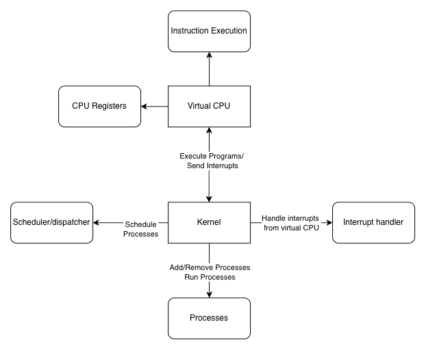

# Py OS
A virtual machine running an operating system.

## Functionality
The following concepts are implemented:
- Virtualized CPU: A primitive, sequential CPU capable of:
  1. executing instructions such as ADD, SUB, Syscall with constant values, memory-addresses and register values
  2. Handling OS-level interrupts (traps).
- SysCalls: Write and Read syscalls are implemented and handled by the virtualized CPU
- Processes: Processes with their own address space, programm counter, stack, etc.
- Scheduler & Dispatcher: Schedule and dispatch different processes with a fair scheduling (linear) algorithm and a dispatcher that is based on number-of-instructions and software-interrupts (instead of time-quanta with hardware-interrupts) based on the virtualized CPU
- Kernel: Handles traps/sys-calls, scheduling, dispatching and context-switching

## Architecture

